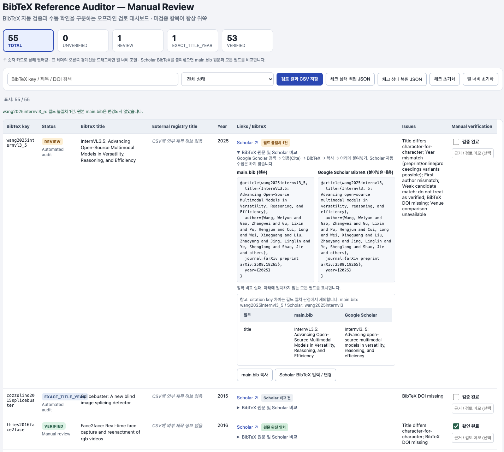

## 실행방법 (Google Scholar)
```bash
python3 -m venv .venv
# .venv/bin/python -m pip install -r requirements.txt
# .venv/bin/python check_bib.py /path/to/main.bib --out audit_results --email you@university.edu
.venv/bin/python check_bib.py main.bib --out audit_results
python3 bibtex_auditor_manual_review/enhance_report.py audit_results/report.csv
```

```bash
open audit_results/report_review.html
```


## 실행방법 (Semantic Scholar api로 자동비교)
```bash
python3 semantic_scholar_auditor/semantic_scholar_report.py \
  audit_results/report.csv --bib main.bib
```


